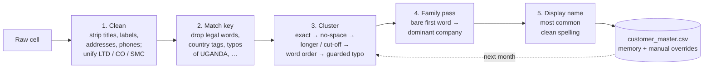

# Customer Entity Resolution for Cargo Manifests


**Turns 172,000 messy spellings of customer names into 33,000 clean, consistent customers, so cargo volumes can finally be counted per customer.**

Built for a transit market-intelligence engagement on East African cargo manifests (Uganda, South Sudan, Tanzania, Ethiopia, 2022–2026). The production data is confidential, so this repository ships the same engine with a **synthetic manifest generator and a reproducible benchmark**.

---

## The problem

Port manifests record the consignee as free text typed by hundreds of clerks. One customer looks like this:

| Raw value in the manifest | Standard customer |
|---|---|
| `MESSRS SUNRISE PLASTICS U LIMTED` | SUNRISE PLASTICS (U) LTD |
| `Sunrise Plastics ( U ) Limited` | SUNRISE PLASTICS (U) LTD |
| `SUNRISE PLASITCS (U) LTD` | SUNRISE PLASTICS (U) LTD |
| `CONSIGNEE: SUNRISE PLASTICS (UGANDA) LIMITED KAMPALA, UGANDA` | SUNRISE PLASTICS (U) LTD |
| `COMPANY NAME: SUNRISE PLASTICS U LTD - P.O BOX 75377, KAMPALA UGANDA P` | SUNRISE PLASTICS (U) LTD |
| `M/S.  SUNRISE PLASTICS (UGANDA)  TEL: +256 791804484 P.O. BOX 68748 KA` | SUNRISE PLASTICS (U) LTD |
| `SUNSET PLASTICS (U) LTD` | SUNSET PLASTICS (U) LTD ← *a different company, kept apart* |

*(85 spellings of this one customer in the sample data; all names in this repo are fictional.)*

Without resolution, a "top customers" table or market-share chart splits one company into dozens of rows. A naive fuzzy match, on the other hand, merges different companies (`SUNRISE` / `SUNSET`, `GROUP 18` / `GROUP 21`) and silently corrupts every number built on top.

## Results

### On the production data (5 years of manifests)

| | |
|---|---|
| Monthly manifest workbooks processed | **47** |
| Customer cells in scope | **962,073** |
| Distinct raw spellings | **172,469** |
| Standard customers after resolution | **33,018** (−81%) |
| Rows correctly flagged as "no consignee" (`TO ORDER …`) | 21,670 |
| Rows recovered by fixing data-format quirks* | **+126,181 (+15%)** |
| Precision audit (v1.0): merged spellings that look very different from their standard name | 44 of 172k, manually reviewed: **2 doubtful (4 rows)** |
| Code review (v1.1): subtler bugs found and fixed, re-checked on all 172k spellings | ~2,500 rows regrouped (0.26%), see [Changelog](#changelog) |
| Time to resolve all 172k spellings | 1–3 minutes on a laptop |

\*While profiling the data I found that about half the months code South Sudan as `SD` instead of `SS`, and that some months keep their data on unnamed sheets (one mixing imports and exports). The first version silently dropped those rows.

### On the synthetic benchmark (reproducible)

12,000 rows · 2,094 raw spellings · 69 true customers, including deliberate look-alike traps.
Metric: B-cubed precision / recall over rows. Precision falls when different customers are merged; recall falls when one customer is split.

| Approach | Names produced | Precision | Recall | **F1** |
|---|---:|---:|---:|---:|
| Exact match | 2,094 | 1.000 | 0.188 | 0.316 |
| Normalized match (case, punctuation) | 1,728 | 1.000 | 0.203 | 0.338 |
| Fuzzy match (RapidFuzz token_set ≥ 85) | 461 | 0.920 | 0.536 | 0.678 |
| This repo, v1.0 | 77 | 0.969 | 0.986 | 0.977 |
| **This repo, v1.1** | **76** | **0.994** | **0.986** | **0.990** |

The fuzzy baseline merges look-alike companies *and* still splits most customers, because addresses and prefixes dominate the strings. Cleaning first, then guarded matching, fixes both.

```bash
python scripts/make_synthetic_data.py   # regenerate data/ (seeded, deterministic)
python scripts/evaluate.py --errors     # table above + the remaining mistakes
```

## How it works



1. **Clean** ([`cleaning.py`](manifest_er/cleaning.py)): removes prefixes (`M/S`, `CONSIGNEE:`, `TO THE ORDER OF`, personal titles), keeps the real customer behind agents (`X JOINTLY AND SEVERALLY WITH Y` → Y), cuts address/contact tails, repairs legal suffixes (`LIMTED`, `CO.,LTD`, `COLTD`, a suffix cut off by the 70-character field) and maps acronyms (`WFP` = `WORLD FOOD PROGRAMME`). Address markers come in three strengths: *hard* ones (P.O. box, plot, phone, TIN, e-mail) always cut. *Word* ones (ROAD, MARKET, BUILDING, MOBILE …) and town names cut only when no legal suffix follows and no business word comes next. So `ACME TRADING JINJA ROAD` → `ACME TRADING`, but `ACME BUILDING MATERIALS LTD` stays whole.
2. **Match key** ([`matching.py`](manifest_er/matching.py)): reduces a name to what identifies the customer. Country words are dropped only at the end of a name (`… PLASTICS UGANDA`). They are kept as first word (`UGANDA GLASSWORKS` ≠ `TANZANIA GLASSWORKS`), after `OF` (`BANK OF UGANDA` ≠ `BANK OF TANZANIA`) and inside a name (`NORTH EAST LOGISTICS` ≠ `NORTH LOGISTICS`).
3. **Cluster:** leader clustering from the most to the least frequent name, with hash indexes so 172k names cluster in seconds. A name joins an existing customer if it is identical, identical without spaces, a longer or cut-off version, a typo-level variant, or (for personal names only) the same 2–3 words in another order (`MUSISI PETER`).
4. **Family pass:** folds a bare first word (`TWIGA`) into the dominant company (`TWIGA AUTO SPARES LTD`), but only if that company owns ≥70% of the family's rows.
5. **Memory:** every decision is stored in `customer_master.csv`, so customers keep the same name month after month. Each run writes `review_new_names.csv` for a quick human check, and any row can be overridden by hand (`manual = yes`).

### Design decisions

- **Precision over recall.** A wrong merge corrupts every downstream number and is hard to see. A missed merge shows up in the review file and takes seconds to fix. Every fuzzy rule is therefore guarded:
  - typos are checked *word by word*: edit distance ≤1 for words up to 8 letters, same first letter for short words, and an extra word or initial means a different name (`JOHN OKELLO` ≠ `JOHN B OKELLO`);
  - numbers must match exactly;
  - short generic names (`GENERAL TRADING`, `UNITED NATIONS`, a bare town) never absorb longer names.
- **Rules + memory instead of a trained model.** There were no labels, every decision had to be explainable to a non-technical client, and names had to stay stable across monthly reports. The rules are plain data in [`rules.py`](manifest_er/rules.py), so extending them needs no code changes.
- **Tested against traps, not just happy paths.** The test suite and the benchmark include look-alike pairs that must *not* merge.

## Quick start

```bash
pip install -r requirements.txt

# add a "Standard Customer" column to any Excel file (writes FILE_clean.xlsx)
python -m manifest_er clean data/sample_manifest.xlsx

# see how a single value is cleaned
python -m manifest_er explain "M/S. Sunrise Plastics (U) Limited, P.O. Box 4412 Kampala"
#   cleaned  : SUNRISE PLASTICS (U) LTD
#   match key: SUNRISE PLASTICS
```

On Windows you can also drag Excel files onto **`clean_names.bat`**.

The output keeps every sheet and row. It inserts `Standard Customer` right after the customer column (found automatically, even below a pivot table) and adds a `Customer Summary` sheet.

**From Python:**

```python
from manifest_er import resolve
resolve(["Twiga Auto Spares Ltd", "TWIGA AUTO SPARES LIMITED P.O BOX 1 KAMPALA", "TO ORDER"])
# {'Twiga Auto Spares Ltd': 'TWIGA AUTO SPARES LTD',
#  'TWIGA AUTO SPARES LIMITED P.O BOX 1 KAMPALA': 'TWIGA AUTO SPARES LTD',
#  'TO ORDER': 'UNIDENTIFIED (TO ORDER)'}
```

## Project structure

```
manifest_er/
  rules.py          domain knowledge as data: markers, aliases, guards
  cleaning.py       raw cell -> clean name
  matching.py       match keys, clustering, family pass, display names
  memory.py         customer_master.csv, standardize(), resolve()
  excel.py          Excel in -> Excel out
  cli.py            `python -m manifest_er clean | explain`
scripts/
  make_synthetic_data.py   messy manifest + ground truth (seeded)
  evaluate.py              B-cubed benchmark vs. baselines
tests/              91 tests: cleaning cases, merge / no-merge traps,
                    Excel round trip, review regressions, benchmark guard
```

## Changelog

**v1.1: fixes from a code review.** A review of v1.0 found 10 bugs that the tests and the benchmark had missed, because neither contained these patterns. Each fix was re-checked on all 172k production spellings. The audit regrouped about 2,500 rows (0.26%) and caught three regressions from the first round of fixes before release. Every case is now a test, and the new patterns were added to the benchmark as traps.

- *Business words read as addresses:* `ACME BUILDING MATERIALS LTD` → `ACME`, `HELLO MOBILE PHONE LTD` → `HELLO`. Address markers now have three strengths (see step 1).
- *Wrong merges:* generic short names absorbing longer ones (`GENERAL TRADING` ⊃ `GENERAL TRADING AND CONTRACTING`), an extra initial passing the typo check (`JOHN B OKELLO`), country words dropped mid-name (`NORTH EAST LOGISTICS` = `NORTH LOGISTICS`), and word order applied to companies (`GOLD RIVER` = `RIVER GOLD`).
- *Over-eager repairs:* `ZHANG LI` → `ZHANG LTD`, `SMITH AND CO` → `SMITH`, `MR PRICE LTD` → `PRICE LTD`.
- *Excel tool:* the customer column picked from a title row or a "Customer Code" column; spellings from a file that failed to save were remembered without review; occurrence counts were never updated. Output is now written atomically.

On the production data the fixes also separated companies the old rules had merged, such as a development *corporation* and a development *bank* with the same first words.

## Limitations

- Two names one letter apart in a short word (`NOVA TRADING` / `NOVO TRADING`) are treated as a typo. Without other evidence (address, tax ID) they cannot be told apart. This is the main remaining error in the benchmark.
- A bare first word (`ZIWA`) is folded into its company only when that company owns ≥70% of the family's rows. Below that it stays separate, by design.
- When a misspelling is a customer's most frequent form, it becomes the display name. The fix is a one-line manual override.
- The address and town rules are tuned for East Africa. Other regions need their own town list in `rules.py`.
- Possible next steps: use the address and TIN that the cleaner strips off as extra matching evidence, and add a small active-learning loop over `review_new_names.csv`.

## About

Built by **Victor Orebo**, data analyst (SQL · Power BI · Python · Excel) working on logistics, maritime and transit data.
[LinkedIn](https://linkedin.com/in/victor-orebo) · [Portfolio](https://sites.google.com/view/victororebo)

MIT licensed. Sample data is synthetic; all company and person names are fictional.
